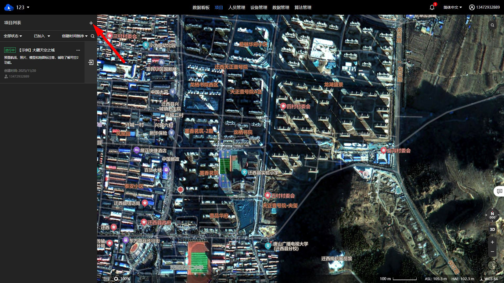
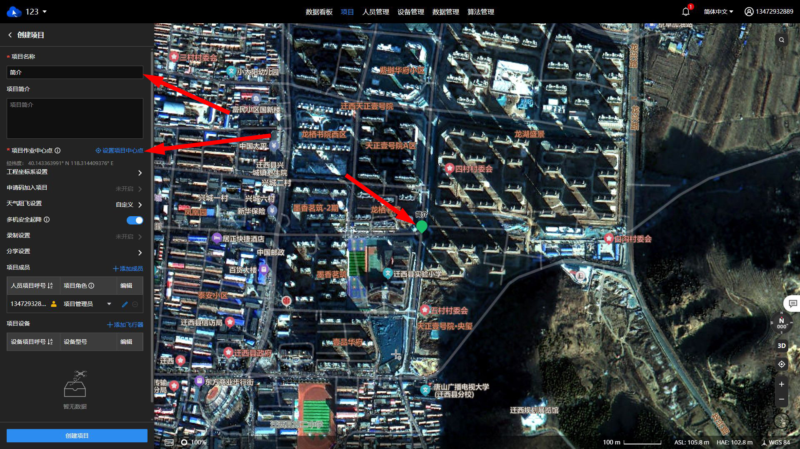
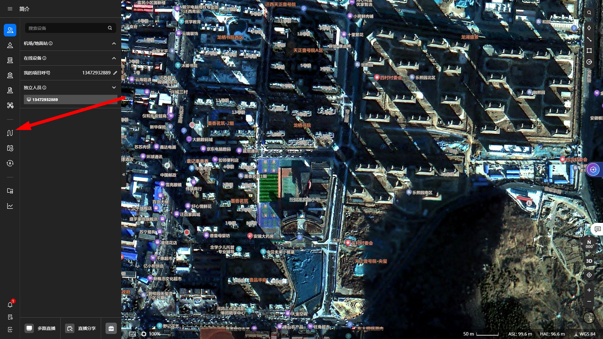
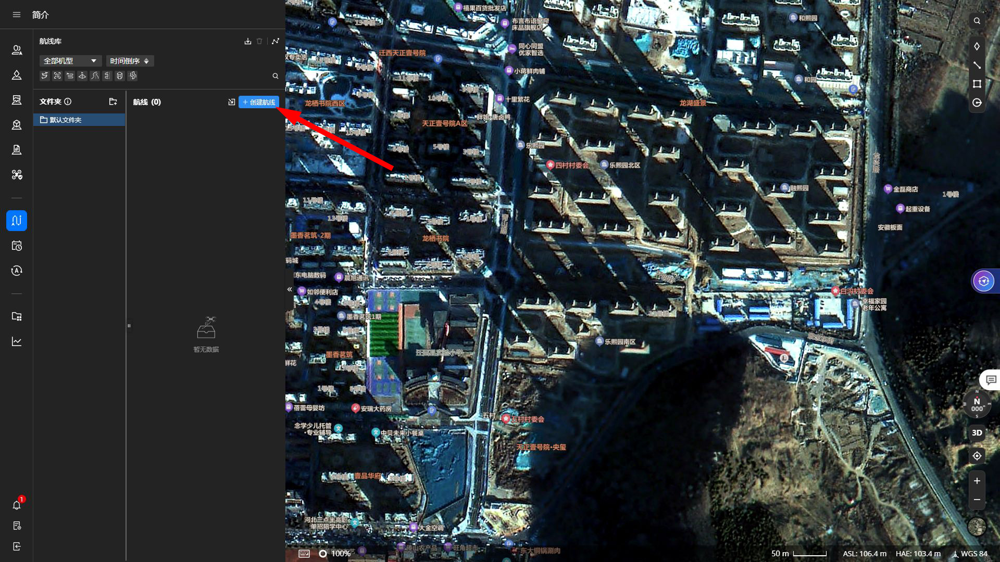
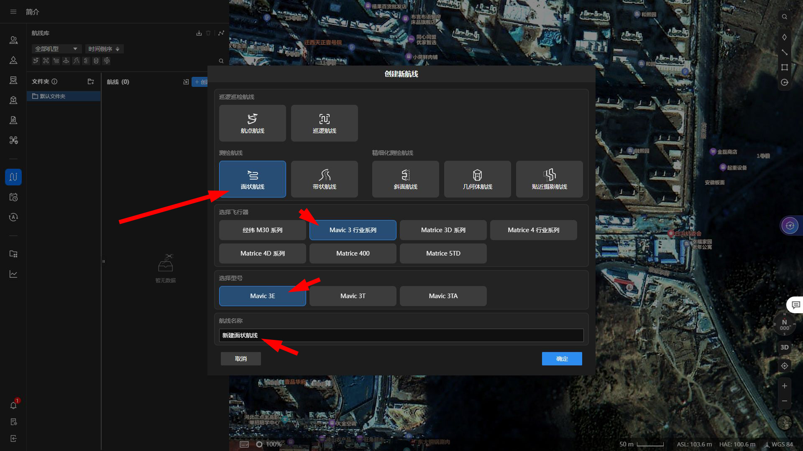
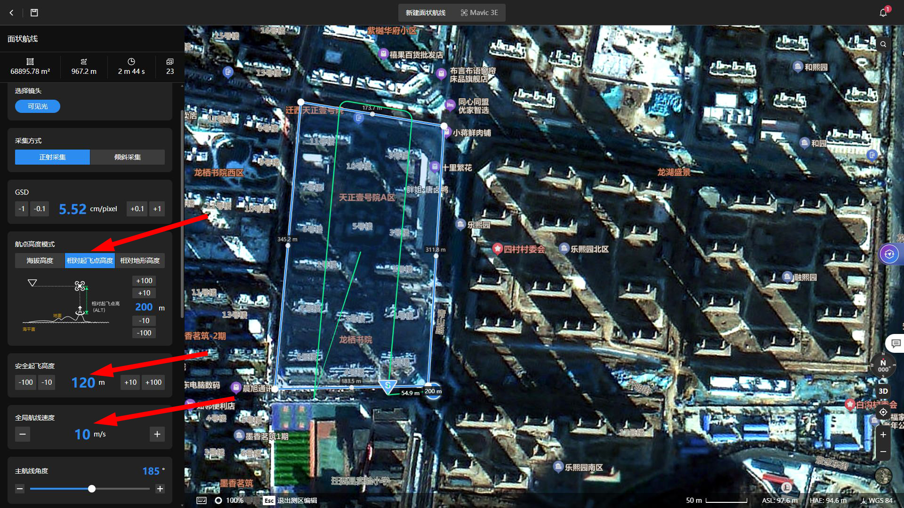
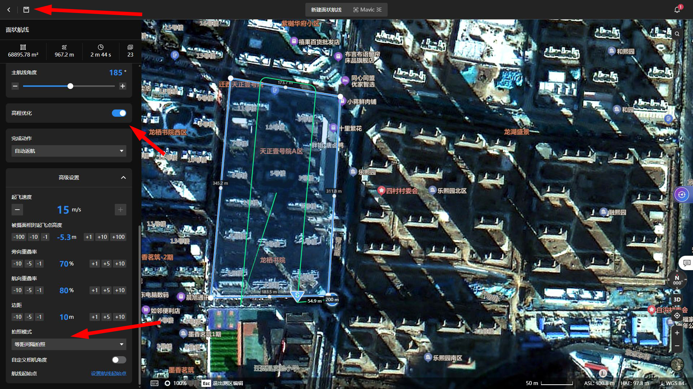
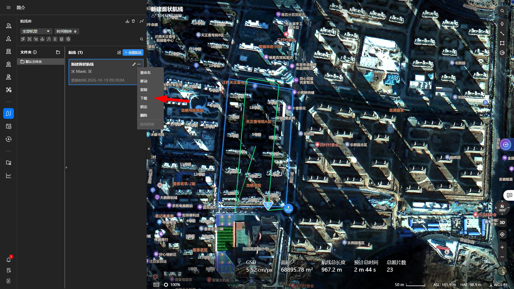

# 无人机航线转换与地形测绘项目

# 无人机航线转换与地形测绘项目

## 一、项目简介

本项目是一套面向大疆消费级无人机的航线转换工具。项目以大疆司空2为航线规划基础，通过解析并转换其生成的航线文件，将规划好的测绘航线转换为支持航点飞行、但不支持完整测绘航线规划功能的无人机可使用的航线文件，从而实现地形测绘。

例如，可利用大疆司空2规划测绘航线，再通过本项目进行航线转换，使Mini 5 Pro等支持航点规划功能的无人机执行相应的测绘任务。具体适用机型取决于无人机、DJI Fly（DJFly）及航线文件格式的兼容性。

### 项目优势

通过航线文件解析、坐标转换及航点插值，可将原本无法直接使用的测绘航线转换为航点飞行航线，扩展部分大疆消费级无人机的测绘应用能力。

### 项目局限性

1. **平台及格式依赖：** 本项目依赖大疆司空2的航线生成机制、无人机航点规划功能及相关航线文件格式。若相关平台、固件或文件格式发生变化，可能导致航线解析、转换或导入失败。
2. **高程精度受限：** 部分仅支持航点规划的消费级无人机无法准确获取或控制航点的实际高程，导致飞行高度与预期不一致，进而影响测绘影像的高程精度。对于高程精度要求较高的任务，可能需要结合地面控制点、外业测量或其他高程校正手段进行处理。
3. **适用范围有限：** 当前项目主要针对正射测绘航线进行适配，其他类型的航线及不同机型的兼容性尚未充分验证。
4. **维护状态：** 本项目为个人探索性实现，主要通过接口分析与AI辅助完成。由于当前已无法在本人所在区域开展无人机飞行测试，项目后续暂不再持续更新，使用前建议充分验证航线文件及飞行安全性。

## 二、项目结构

```text
项目根目录/
├── example/                  # 示例航线文件
│   ├── template.kml
│   └── waylines.wpml
├── res/                      # 输入数据及中间处理文件
│   ├── attribute.csv         # 航线属性
│   ├── coord_wgs84.csv       # 原始航点坐标（WGS84）
│   ├── coord_cgcs.csv        # 原始航点坐标（CGCS2000）
│   ├── interpolate_cgcs.csv  # 插值后的航点坐标（CGCS2000）
│   └── interpolate_wgs84.csv # 插值后的航点坐标（WGS84）
├── photo/                    # README配图
├── wpmz/                     # 最终生成的航线文件
├── read_point.py             # 解析原始航线文件
├── coord_trans.py            # 坐标转换
├── interpolate.py            # 航点插值
├── create_wpml.py            # 生成waylines.wpml
└── create_template.py        # 生成template.kml
```
注：上述目录结构根据项目处理流程整理，实际文件名、扩展名及输出位置请以项目中的代码为准。

### 主要文件说明

**`example/`：示例文件**

存放通过大疆Mini 5 Pro航点规划功能生成的示例文件，包括`template.kml`和`waylines.wpml`，用于参考航线文件的结构及属性配置。

**`res/`：数据处理目录**

存放航线解析结果、属性参数及坐标转换和插值过程中产生的中间文件。

- `attribute.csv`：航线属性文件。其中，`height`表示相对起飞点高度，`speed`表示飞行速度，`dis`和`distance`分别表示直线航线及高程优化部分的两航点之间的距离。
- `coord_wgs84.csv`：从`waylines.wpml`中提取的原始航点坐标，原坐标为WGS84坐标系。
- `coord_cgcs.csv`：将原始航点坐标转换至CGCS2000坐标系后的结果。
- `interpolate_cgcs.csv`：在CGCS2000坐标系下完成航点插值后的坐标数据，包含正射测绘航线及高程优化相关部分。
- `interpolate_wgs84.csv`：将插值后的航点坐标转换回WGS84坐标系后的结果。

**`photo/`：文档配图目录**

存放README使用的操作界面截图。

**`wpmz/`：航线输出目录**

存放最终生成的航线文件及相关文件。

**Python脚本说明**

- `read_point.py`：读取`waylines.wpml`中的航点坐标，并将其保存至`res/coord_wgs84.csv`；同时提取航线全局属性并保存至`res/attribute.csv`。
- `coord_trans.py`：执行坐标系转换。使用`True`对应的处理分支时，将原始WGS84坐标转换为CGCS2000坐标；使用`False`对应的处理分支时，将插值后的CGCS2000坐标转换为WGS84坐标。
- `interpolate.py`：根据`attribute.csv`中的距离参数，对原始航线进行航点插值，并分别处理正射测绘航线及高程优化相关部分，生成`res/interpolate_cgcs.csv`。
- `create_wpml.py`：根据处理后的航点坐标和相关属性，生成可供目标无人机使用的`waylines.wpml`文件。
- `create_template.py`：生成航线任务模板文件`template.kml`。由于模板文件通常具有一定的通用性，正常情况下无需重复生成，具体以目标机型的文件要求为准。
- `plot.py`：用于3d展示插值后的航线

## 三、使用方法

### 3.1 前期航线准备：大疆司空2

#### 3.1.1 创建项目

首先，登录大疆司空2，进入项目列表，点击“+”新建项目。项目创建完成后，后续可直接在该项目中规划航线，无需重复创建。

填写项目名称及项目作业中心点，确认无误后点击“创建项目”。

#### 3.1.2 创建测绘航线

进入项目主页，点击“航线库”。

点击“+”创建航线。

在航线创建界面中，按以下方式选择参数：
- 航线类型：测绘航线中的面状航线。
- 机型：御3行业系列。
- 型号：御3E。
- 航线名称：根据实际测绘任务填写。
完成设置后，点击“确定”。

#### 3.1.3 设置航线参数

选取起飞点和测绘区域，并根据实际作业需求设置航线参数。


航线规划过程中需要注意以下事项：
1. **航线类型：** 当前项目主要适配正射测绘航线，其他类型的航线尚未充分验证。
2. **飞行高度：** 消费级无人机通常主要使用相对起飞点高度，无法直接使用部分行业级测绘设备支持的其他高度模式。具体能力应以目标机型为准。
3. **安全起飞高度：** 平台默认提供的安全起飞高度为20m，应结合起飞点周围的地形、障碍物及飞行环境合理设置，不要直接沿用默认值。
4. **航线速度：** 全局航线速度不宜设置过高。若相邻航点之间的飞行时间不足6s，可能导致无人机拍照后处理及存储文件无法及时完成。该数值为Mini 5 Pro使用经验，并非适用于所有机型的通用限制。
5. **高程优化：** 按照原有工作流程启用高程优化功能，拍照模式选择等距拍照。
6. **任务时长与照片数量：** 提前检查预计飞行时间和照片数量。由于消费级无人机的高程控制及测量精度可能存在限制，建议尽量确保整个测绘任务能够连续完成；如需分段飞行，应重新检查各段航线的高度基准及衔接情况。
7. **保存航线：** 确认参数设置无误后，点击页面左上角的“保存”。

#### 3.1.4 下载航线文件

航线保存完成后，返回航线列表，点击对应航线旁的“三个点”菜单，选择“下载”，获取航线文件。


下载完成后，按照以下步骤准备输入文件：
1. 将下载得到的`.kmz`文件扩展名修改为`.zip`。
2. 解压ZIP文件。
3. 将解压后得到的航线文件放入`res/`目录或对应的输入目录。
4. 检查文件路径、文件名及文件内容，确保后续脚本能够正确读取。
注意：修改扩展名并不等于转换文件格式。上述操作适用于本项目所处理的、内部采用ZIP容器封装的KMZ文件。解压后应保留原有目录层级，避免遗漏必要文件。

### 3.2 项目内的数据处理

完成航线准备后，按照以下顺序执行脚本。建议在项目根目录下运行，以保证相对路径能够正确解析。

**步骤一：提取原始航点及航线属性**
运行`read_point.py`，解析输入航线文件，提取原始航点坐标及全局航线属性，生成`res/coord_wgs84.csv`和`res/attribute.csv`。

**步骤二：将原始坐标转换为CGCS2000坐标**
根据你项目所在地选取epsg编号，修改`coord_trans.py`中对cgcs的编号。
运行`coord_trans.py`，执行`True`对应的处理分支，将原始航点坐标从WGS84坐标系转换至CGCS2000坐标系，生成`res/coord_cgcs.csv`。

**步骤三：对航线进行插值**
运行`interpolate.py`，根据`res/attribute.csv`中的距离参数，对原始航线进行插值。按照现有程序逻辑，分别处理直线航线及高程优化相关部分，生成`res/interpolate_cgcs.csv`。

**步骤四：将插值坐标转换回WGS84坐标**
再次运行`coord_trans.py`，执行`False`对应的处理分支，将插值后的航点坐标从CGCS2000坐标系转换至WGS84坐标系，生成`res/interpolate_wgs84.csv`。

**步骤五：生成航线文件**
运行`create_wpml.py`，根据插值后的航点坐标及航线属性，生成目标无人机可使用的`waylines.wpml`文件。生成结果应保存至`wpmz/`目录。

**步骤六：处理航线模板文件**
通常情况下，可沿用已有的`template.kml`文件，无需重复生成。如目标无人机或航线任务要求更新模板文件，则需重新编写并运行`create_template.py`，并检查生成文件与航线任务的兼容性。

**步骤七：打包生成KMZ航线文件**
确认`wpmz/`目录下的文件完整、目录结构正确后，将需要交付的航线文件及相关目录打包为ZIP文件，再将扩展名由`.zip`修改为`.kmz`。
注意：KMZ文件内部的目录层级和文件命名需要符合目标平台的航线格式要求。不要仅凭扩展名判断文件是否可用，建议先进行导入测试。

### 3.3 在 DJI Fly（DJFly）中使用航线

完成航线转换及打包后，可按照以下流程尝试导入目标航线：
1. 使用目标无人机及其配套的 DJI Fly（DJFly）应用，创建一条普通航点航线并保存，用于生成目标设备认可的航线文件结构。
2. 在手机中找到该航点航线对应的文件目录，确认文件名及其存储位置。
3. 备份原始航线文件，将本项目生成的KMZ文件复制到对应目录，并按照目标航线文件的实际命名规则修改文件名。
4. 在确认文件结构、文件名及相关参数兼容的前提下，替换相应航线文件。
5. 重新打开DJI Fly（DJFly），检查航线是否能够正常显示、加载和编辑。若无法识别，应恢复原始文件，并检查航线文件格式及目录结构。
**重要提示：** 不同手机系统、DJI Fly版本及无人机型号的航线存储位置和文件格式可能不同。替换航线文件属于基于文件格式的兼容性尝试，并非官方支持的通用导入方法。请勿在未经检查的情况下直接执行飞行任务。

## 四、注意事项与免责声明

本项目仅用于技术研究及个人测绘工作流程探索，不代表大疆官方提供或认可的解决方案。
通过本项目生成的航线，可能存在坐标转换误差、航点插值误差、高程偏差、拍照位置偏差及文件格式兼容性问题。使用前应充分验证航线的坐标、相对高度、飞行速度、拍照设置和安全参数。
首次使用时，建议在安全、合法且符合当地飞行管理要求的环境下开展地面检查和低风险验证，确认航线与预期一致后再开展正式作业。不得仅依据生成文件能够成功导入，就认定航线能够安全执行。
本项目的处理流程、适用机型及文件格式兼容性均未经全面验证，使用者需自行评估相关风险，并对实际飞行操作及测绘成果负责。
由于本人所在区域目前无法开展无人机飞行测试，项目后续暂不再更新。欢迎参考现有代码进行学习与研究，但请注意相关平台及设备更新可能造成的兼容性变化。
